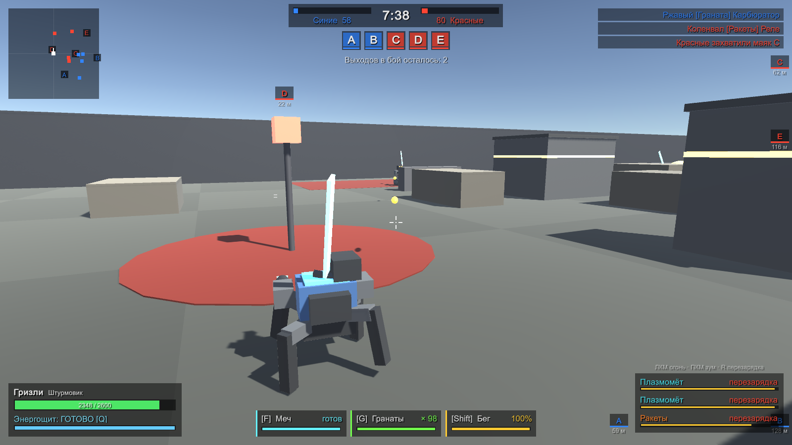
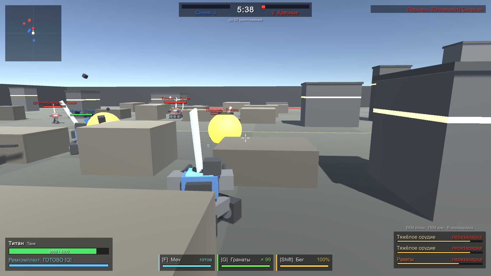
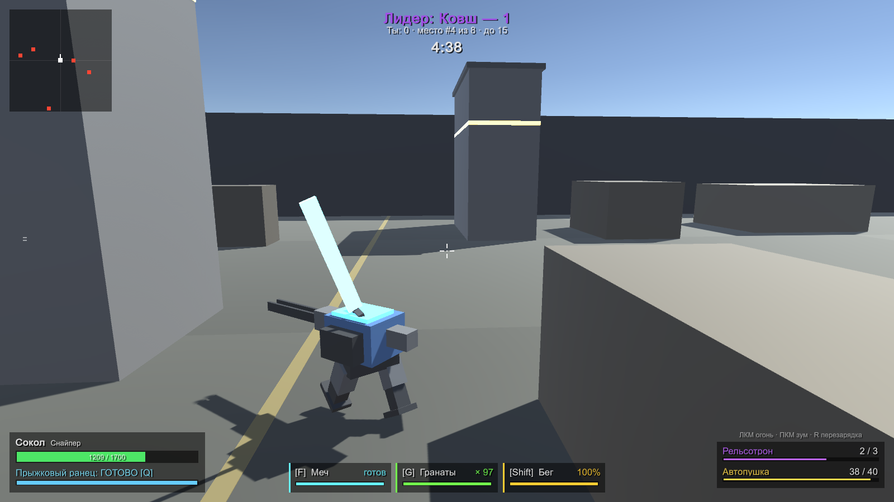
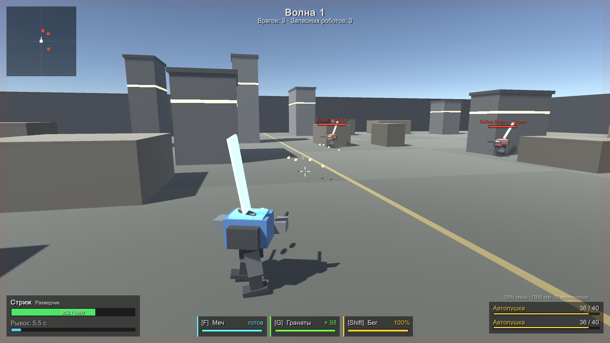
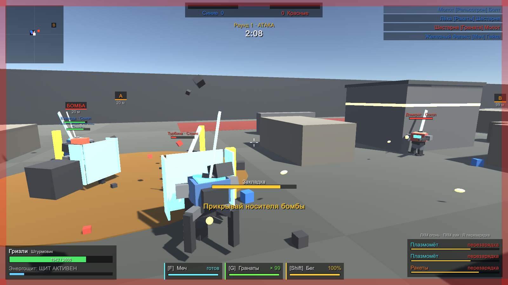

# Битва роботов (Robots Fight)

Меха-бои на Unity в духе War Robots и Armored Squad: 4 робота, 5 режимов, боты с ИИ, меч и гранаты.
Всё — арена, роботы, интерфейс, музыка — генерируется кодом, без внешних ассетов.


## Быстрый старт

| Что | Как |
|---|---|
| Собрать игру | `build.bat` → `Builds\Windows\RobotsFight.exe` (лог: `Logs\build.log`) |
| Запустить | `run.bat` (если сборки нет — сначала соберёт). Аргументы пробрасываются в игру, например `run.bat -screen-fullscreen 1` |
| Обновить скриншоты | `screenshots.bat` → `docs\screenshots` (~2 минуты, боты играют сами) |
| Из редактора | Открыть папку в Unity Hub (Unity **6000.0.77f1**), сцена `Assets/Scenes/Main.unity`, Play |

`build.bat` берёт версию Unity из `ProjectSettings\ProjectVersion.txt` и ищет её в стандартной папке Unity Hub.
Если Unity стоит в другом месте — задай переменную `UNITY_PATH` с путём к `Unity.exe`.
Перед сборкой закрой проект в редакторе: Unity не даёт открыть один проект дважды.

## Режимы

| | Режим | Правила |
|---|---|---|
|  | **Захват маяков** | 5 на 5, пять маяков. Удерживаемые маяки приносят очки. Победа — 1000 очков или пустой ангар врага. У каждого пилота 3 выхода в бой. |
|  | **Командный бой** | 5 на 5, первая команда с 25 уничтожениями побеждает. 6 минут. |
|  | **Все против всех** | 8 пилотов, каждый сам за себя. До 15 уничтожений, 5 минут. |
|  | **Выживание** | Один против волн ботов, каждая волна больше и толще. 3 запасных робота, рекорд сохраняется. |
|  | **Бомба** | 5 на 5, раунды до 3 побед. Атака несёт бомбу на точку A или B и закладывает (держать **E**), защита разминирует. Стороны меняются каждый раунд. |

## Роботы

| Робот | Роль | Прочность | Скорость | Оружие | Способность |
|---|---|---|---|---|---|
| Стриж | Разведчик | 1400 | 10 | 2× Автопушка | Рывок |
| Гризли | Штурмовик (паук) | 2600 | 7 | 2× Плазмомёт, Ракеты | Энергощит (−70% урона, 5 с) |
| Титан | Танк (гусеницы) | 4200 | 4.5 | 2× Тяжёлое орудие, Ракеты | Ремкомплект (+35% за 3 с) |
| Сокол | Снайпер | 1700 | 7.5 | Рельсотрон, Автопушка | Прыжковый ранец |

У каждого робота в инвентаре:
- **Меч** — выпад вперёд и удар дугой перед собой, 450 урона, перезарядка 1.4 с.
- **Гранаты** — 99 штук на каждый выход в бой (у ботов тоже), летят по дуге в точку прицела (до 55 м), взрыв радиусом 7 м.
  Количество — константа `GrenadesPerDrop` в `Catalog.cs`.

Все роботы умеют прыгать и бегать; ранец Сокола — это отдельный суперпрыжок поверх обычного.

## Управление

| Клавиша | Действие |
|---|---|
| WASD | Движение |
| Shift (зажать) | Бег ×1.6, тратит выносливость (~4 с, восстанавливается через секунду после остановки) |
| Space | Прыжок |
| Мышь | Обзор / прицел |
| ЛКМ | Огонь из всего оружия |
| ПКМ | Зум (у снайпера сильнее) |
| R | Перезарядка |
| Q | Способность робота |
| F | Меч |
| G | Граната |
| E | Заложить / разминировать бомбу |
| Tab | Таблица очков |
| Esc | Пауза (чувствительность мыши, громкость музыки) |
| M | Музыка вкл/выкл |
| 1–4 | Пока уничтожен — выбор следующего робота |

## Музыка

По умолчанию музыка синтезируется прямо в коде (`Scripts/Music.cs`): спокойный трек в меню и боевой в бою.
Чтобы поставить свои треки, положи файлы в `Assets/RobotsFight/Resources/Music/` с именами `menu` и `battle`
(mp3 / ogg / wav) — они заиграют вместо синтезатора. Используй только музыку, на которую у тебя есть права.

## Структура

```
Assets/RobotsFight/
  Scripts/
    GameRoot.cs      точка входа: меню с демо-боем, пауза, итоги, автотест, скриншоты
    Match.cs         пилоты, спавн, урон, килфид
    Modes.cs         5 режимов боя
    Robot.cs         тело робота: движение, торс, оружие, способности, меч, гранаты
    Weapons.cs       оружие, снаряды, эффекты
    Brains.cs        управление игрока и ИИ ботов
    Catalog.cs       характеристики роботов и оружия
    Arena.cs         генерация карты
    PlayerCamera.cs  камера от третьего лица
    Hud.cs           интерфейс
    Music.cs         музыка и синтезатор
    GameInput.cs     ввод (старый Input Manager и новый Input System)
  Editor/RobotsFightTools.cs   меню «Robots Fight»: создать сцену, собрать билд
  Resources/                   базовые материалы (нужны, чтобы шейдер попал в билд)
```

Баланс крутится в `Catalog.cs`: урон, скорострельность, магазины, прочность и скорость роботов.

## Автотест

Боты сами отыгрывают все 5 режимов на ускорении, в конце выводится сводка и число ошибок:

```
Builds\Windows\RobotsFight.exe -batchmode -nographics -autotest -logFile autotest.log
```

Код возврата 0 — ошибок нет. Параметры: `-autotestScale 12` (ускорение времени), `-autotestTime 900` (лимит игрового времени на режим, сек).

## Ограничения

- Звуков выстрелов и взрывов пока нет — только музыка.
- Роботы собраны из примитивов; модели с Asset Store можно навесить на тот же код.
- Только одиночная игра против ботов, мультиплеера нет.
- При первом старте боя возможен фриз на долю секунды, пока синтезируется трек.
