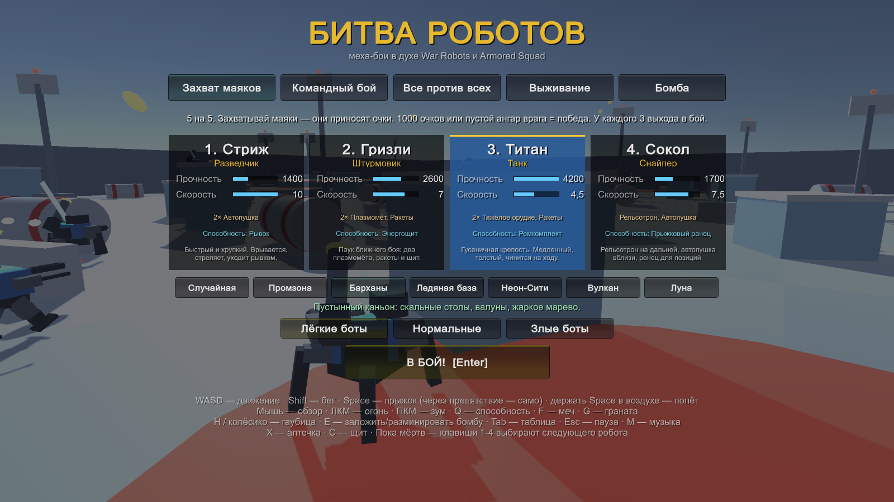
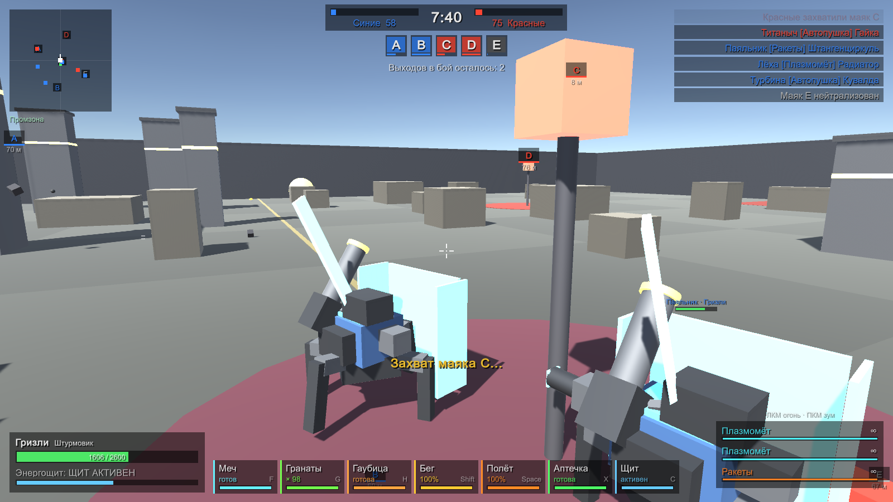
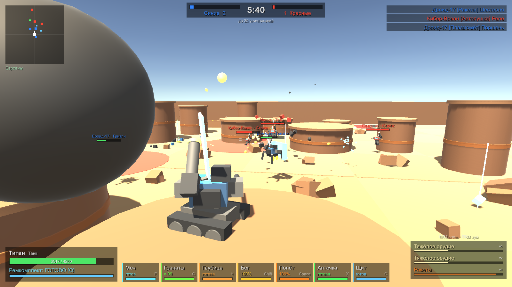
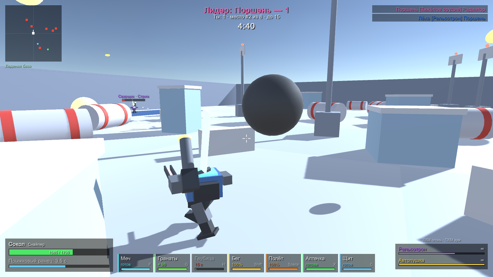
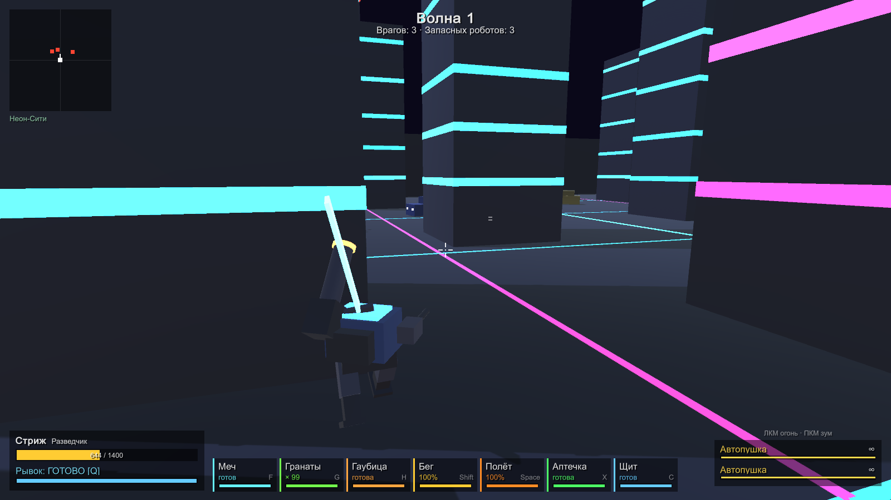
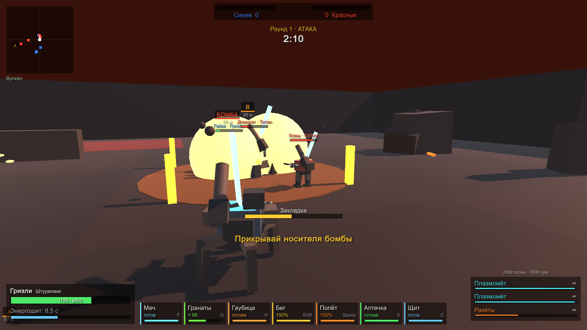
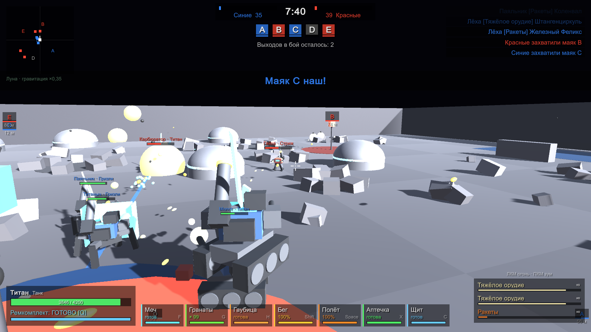

# Битва роботов (Robots Fight)

Меха-бои на Unity в духе War Robots и Armored Squad: 4 робота, 5 режимов, 6 локаций, боты с ИИ,
меч, гранаты, гаубица, прыжки через препятствия и полёт на ранце.
Всё — арены, роботы, интерфейс, музыка — генерируется кодом, без внешних ассетов.



## Быстрый старт

| Что | Как |
|---|---|
| Собрать игру | `build.bat` → `Builds\Windows\RobotsFight.exe` (лог: `Logs\build.log`) |
| Запустить | `run.bat` (если сборки нет — сначала соберёт). Аргументы пробрасываются в игру, например `run.bat -screen-fullscreen 1` |
| Обновить скриншоты | `screenshots.bat` → `docs\screenshots` (~2.5 минуты, боты играют сами) |
| Из редактора | Открыть папку в Unity Hub (Unity **6000.0.77f1**), сцена `Assets/Scenes/Main.unity`, Play |

`build.bat` берёт версию Unity из `ProjectSettings\ProjectVersion.txt` и ищет её в стандартной папке Unity Hub.
Если Unity стоит в другом месте — задай переменную `UNITY_PATH` с путём к `Unity.exe`.
Перед сборкой закрой проект в редакторе: Unity не даёт открыть один проект дважды.

## Локации

Выбираются в меню (или «Случайная»). Точки маяков, бомбы и спавнов на всех картах одинаковые — любой режим работает на любой локации.
У каждой локации свой синтезированный трек.

| | Локация | Особенности |
|---|---|---|
|  | **Промзона** | Разрушенный индустриальный квартал: бетонные блоки и цеха. Музыка — техно. |
|  | **Барханы** | Пустынный каньон: скальные столы, валуны, жаркое марево. Музыка — восточный халфтайм. |
|  | **Ледяная база** | Метель, ледяные глыбы, топливные баки, радарные вышки. Густой туман — видимость хуже. |
|  | **Неон-Сити** | Ночной мегаполис: небоскрёбы с неоновыми окнами, машины-укрытия. Музыка — синтвейв. |
|  | **Вулкан** | Базальтовые скалы и **лавовые озёра — жгут 220 урона/с**. Боты их обходят, над лавой можно пролететь. Музыка — брейкбит. |
|  | **Луна** | Кратеры и купола, чёрное небо, **гравитация ×0.35**: прыжки выше, полёт дольше, снаряды летят по пологим дугам. |

## Режимы

| Режим | Правила |
|---|---|
| **Захват маяков** | 5 на 5, пять маяков. Удерживаемые маяки приносят очки. Победа — 1000 очков или пустой ангар врага. У каждого пилота 3 выхода в бой. |
| **Командный бой** | 5 на 5, первая команда с 25 уничтожениями побеждает. 6 минут. |
| **Все против всех** | 8 пилотов, каждый сам за себя. До 15 уничтожений, 5 минут. |
| **Выживание** | Один против волн ботов, каждая волна больше и толще. 3 запасных робота, рекорд сохраняется. |
| **Бомба** | 5 на 5, раунды до 3 побед. Атака несёт бомбу на точку A или B и закладывает (держать **E**), защита разминирует. Стороны меняются каждый раунд. |

## Роботы

| Робот | Роль | Прочность | Скорость | Оружие | Способность |
|---|---|---|---|---|---|
| Стриж | Разведчик | 1400 | 10 | 2× Автопушка | Рывок |
| Гризли | Штурмовик (паук) | 2600 | 7 | 2× Плазмомёт, Ракеты | Энергощит (−70% урона, 5 с) |
| Титан | Танк (гусеницы) | 4200 | 4.5 | 2× Тяжёлое орудие, Ракеты | Ремкомплект (+35% за 3 с) |
| Сокол | Снайпер | 1700 | 7.5 | Рельсотрон, Автопушка | Прыжковый ранец |

Магазинов и перезарядки у оружия нет — стреляешь без остановки, темп ограничен только скорострельностью.

У каждого робота в инвентаре (слоты внизу экрана):
- **Меч [F]** — выпад вперёд и удар дугой перед собой, 450 урона, откат 1.4 с.
- **Гранаты [G]** — 99 штук на каждый выход в бой (у ботов тоже), летят по дуге в точку прицела (до 55 м), взрыв радиусом 7 м.
- **Гаубица [H / колёсико]** — ствол на спине. Навесной снаряд в точку прицела на дистанцию до 260 м, взрыв радиусом 12 м,
  откат 15 с. На месте падения загорается красный круг — предупреждение для всех, можно успеть увернуться.
  Боты бьют ей по дальним врагам, даже не видя их.
- **Аптечка [X]** — +40% прочности за 1 с, откат 8 с. При полном здоровье не тратится.
- **Щит [C]** — энергощит на 4 с, −70% входящего урона, откат 10 с.

Аптечку и щит по кнопкам можно юзнуть в любой момент боя, независимо от способности робота. Короткий откат оставлен
специально: без него это бессмертие. Если всё же хочется — обнули `MedkitCooldown` и `ShieldItemCooldown` в `Robot.cs`.

**Дроп.** Из каждого уничтоженного робота выпадает аптечка или щит (светящийся предмет со столбом света, виден на радаре,
лежит 30 с). Подбирает любой, кто наступит, — эффект сразу. Аптечку при полном здоровье не подобрать — она останется лежать.
**Боты пользуются только дропом**: своих аптечек и щитов по кнопке у них нет. Подбитый бот сам идёт за аптечкой поблизости.

Передвижение у всех роботов:
- **Бег [Shift]** — скорость ×1.6, тратит выносливость (~4 с).
- **Прыжок [Space]** — если прямо по курсу препятствие до 7 м высотой, робот сам рассчитает прыжок и перемахнёт через него.
  Иначе — обычный прыжок. Боты тоже перепрыгивают препятствия вместо обхода.
- **Полёт [держать Space в воздухе]** — реактивный ранец: подъём и ×1.3 скорости, топлива на ~5 с, заправляется на земле.
  Потолок — 45 м, за стены арены не улететь.

Ранец Сокола (способность [Q]) — отдельный мгновенный суперпрыжок поверх всего этого.
Балансные числа — в `Catalog.cs` и константах в начале `Robot.cs`.

## Управление

| Клавиша | Действие |
|---|---|
| WASD | Движение |
| Shift (зажать) | Бег |
| Space | Прыжок / прыжок через препятствие |
| Space (держать в воздухе) | Полёт на ранце |
| Мышь | Обзор / прицел |
| ЛКМ | Огонь из всего оружия |
| ПКМ | Зум (у снайпера сильнее) |
| Q | Способность робота |
| F | Меч |
| G | Граната |
| H / колёсико мыши | Гаубица |
| X | Аптечка |
| C | Щит |
| E | Заложить / разминировать бомбу |
| Tab | Таблица очков |
| Esc | Пауза (чувствительность мыши, громкость музыки) |
| M | Музыка вкл/выкл |
| 1–4 | Пока уничтожен — выбор следующего робота |

## Музыка

Музыка синтезируется прямо в коде (`Scripts/Music.cs`): трек меню и свой трек на каждую локацию — разные темп,
гармония, ударные и тембр. Все треки рендерятся в фоновых потоках при запуске, поэтому старт боя без фризов.

Свои треки: положи файлы (mp3 / ogg / wav) в `Assets/RobotsFight/Resources/Music/`:
- `menu` — для меню;
- `industrial`, `desert`, `snow`, `city`, `volcano`, `moon` — для конкретной локации;
- `battle` — для всех локаций, у которых нет своего файла.

Используй только музыку, на которую у тебя есть права.

## Структура

```
Assets/RobotsFight/
  Scripts/
    GameRoot.cs      точка входа: меню с демо-боем, пауза, итоги, автотест, скриншоты
    Match.cs         пилоты, спавн, урон, лава, килфид
    Modes.cs         5 режимов боя
    Maps.cs          6 локаций: цвета, освещение, гравитация, музыкальный стиль
    Arena.cs         генерация карты по локации
    Robot.cs         тело робота: движение, прыжки, полёт, торс, оружие, способности, меч, гранаты, гаубица
    Weapons.cs       оружие, снаряды, эффекты
    Brains.cs        управление игрока и ИИ ботов
    Catalog.cs       характеристики роботов и оружия
    PlayerCamera.cs  камера от третьего лица
    Hud.cs           интерфейс
    Music.cs         музыка и синтезатор
    GameInput.cs     ввод (старый Input Manager и новый Input System)
  Editor/RobotsFightTools.cs   меню «Robots Fight»: создать сцену, собрать билд
  Resources/                   базовые материалы (нужны, чтобы шейдер попал в билд)
```

## Автотест

Боты сами отыгрывают каждую из 6 локаций (режимы по кругу — так покрыты все карты и все режимы) на ускорении.
В конце — сводка: результат, убийства, сколько раз перепрыгнули препятствия, взлетели и выстрелили из гаубицы, число ошибок.

```
Builds\Windows\RobotsFight.exe -batchmode -nographics -autotest -logFile autotest.log
```

Код возврата 0 — ошибок нет. Параметры: `-autotestScale 12` (ускорение времени), `-autotestTime 900` (лимит игрового времени на матч, сек).

## Ограничения

- Звуков выстрелов и взрывов пока нет — только музыка.
- Роботы собраны из примитивов; модели с Asset Store можно навесить на тот же код.
- Только одиночная игра против ботов, мультиплеера нет.
